# BsOW diagrams

Mermaid diagrams of the code on `prototype`. GitHub renders them directly; in VS Code, install
the *Markdown Preview Mermaid Support* extension and open the Markdown preview.

**Reading the class diagrams:** every field listed on a `data/` or `logic/` class is read and written
through `get_x()` / `set_x()` (or `is_x()` / `has_x()` / `can_x()`), and those accessors go through
`AbilitySystem.resolve_get()` / `resolve_set()`. The accessors themselves are left out to keep the
diagrams small.

1. [Data resources](#1-data-resources-authored-templates)
2. [Abilities](#2-abilities)
3. [Runtime model](#3-runtime-model)
4. [Managers and actors](#4-managers-and-actors)
5. [Screens, scene tree and signal wiring](#5-screens-scene-tree-and-signal-wiring)
6. [HUD and board markers](#6-hud-and-board-markers)
7. [The Action pipeline](#7-the-action-pipeline)
8. [Playthrough: menus, setup and two rounds](#8-playthrough-menus-setup-and-two-rounds)
9. [Who built what](#9-who-built-what)

---

## 1. Data resources (authored templates)

`*Data` classes are `Resource`s authored in the inspector and saved as `.tres`. They are shared by every
instance made from them, so an ability that should affect *one* unit hooks `UnitInstance`, not `UnitData`.

```mermaid
classDiagram
    direction LR

    class SpeciesData {
        +String display_name
        +String description
        +Array~BuildingData~ buildings
        +Array~UnitData~ units
        +Array~BiomeData~ starting_biomes
        +BuildingData command_tower
        +Array~Ability~ abilities
    }

    class UnitData {
        +UnitData base
        +String display_name
        +PackedScene mesh_scene
        +Texture2D icon
        +EconData cost
        +UnitType unit_type
        +DamageData damage
        +bool can_build
        +Array~BuildingData~ buildables
        +Array~Ability~ abilities
        +is_or_inherits(other) bool
    }

    class UnitType {
        <<enumeration>>
        NULL
        MELEE_BASIC
        MELEE_ADVANCED
        RANGED_BASIC
        RANGED_ADVANCED
        SPECIAL
    }

    class BuildingData {
        +String display_name
        +EconData cost
        +EconData upkeep
        +PackedScene mesh_scene
        +Texture2D icon
        +bool is_unique
        +bool overrides_unit_capacity
        +int unit_capacity
        +bool can_spawn
        +Array~UnitType~ spawnable_unit_types
        +bool can_upgrade
        +Array~BuildingData~ upgrades
        +Array~Ability~ abilities
    }

    class BiomeData {
        +String display_name
        +Material mesh_material
        +Texture2D icon
        +EconData upkeep
    }

    class DamageData {
        +int dice_count
        +int dice_sides
        +int modifier
    }

    class EconData {
        +Array~StringName~ RESOURCE_KEYS$
        +int gold
        +int food
        +int mineral
        +int wood
        +int stone
        +amounts_changed() signal
        +get_amount(key) int
        +set_amount(key, value)
        +can_afford(cost) bool
        +add(other)
        +subtract(other)
    }

    class MatchSettings {
        <<Node>>
        +int opponent_count = 2
        +int starting_biome_count = 4
        +int starting_resource_amount = 10
        +int upkeep_gold = 3
        +float ai_step_delay
        +Array~BiomeData~ game_biomes
        +Array~Ability~ rule_abilities
        +int map_size
        +int max_attacker_units
        +int max_defender_units
        +pick_starting_biomes(species) Array
    }

    SpeciesData --> BuildingData : buildings, command_tower
    SpeciesData --> UnitData : units
    SpeciesData --> BiomeData : starting_biomes
    SpeciesData --> Ability : race traits
    UnitData --> UnitData : base (inherits unset fields)
    UnitData --> UnitType
    UnitData --> DamageData : damage
    UnitData --> EconData : cost
    UnitData --> BuildingData : buildables
    UnitData --> Ability : unit traits
    BuildingData --> EconData : cost, upkeep
    BuildingData --> BuildingData : upgrades
    BuildingData ..> UnitType : spawnable_unit_types
    BuildingData --> Ability : effects on its lander
    BiomeData --> EconData : upkeep
    MatchSettings --> BiomeData : game_biomes
    MatchSettings --> Ability : rule_abilities
```

`EconData` plays two roles: a **price or income** (`UnitData.cost`, `BiomeData.upkeep`,
`BuildingData.upkeep`) and an actor's **wallet**. `UnitData.base` is an inheritance chain: a
`UnitData` that leaves a field empty (cost, damage, buildables, abilities) falls back to its `base`.

Current content: two races, **Lycanthrope** (Lycanth Halfbreed, Alpha Werewolf, Moon Den) and
**Ettercap** (Ettercap spawn, Venom Spitter, Web Spire); buildings Base (command tower, +2 food),
Castle Tower, Moon Den and Web Spire; biomes Plains (2 food), Forest (2 wood), Mountain (1 mineral,
1 stone) and Badlands (2 gold).

---

## 2. Abilities

An ability is a `Resource` script that extends `Ability`, saved as a `.tres` in `data/abilities/` and
attached to a race, a kind of unit, a building or the match rules (section 1). Every hook does nothing
by default; each ability overrides the ones it needs and decides for itself whether it fires.

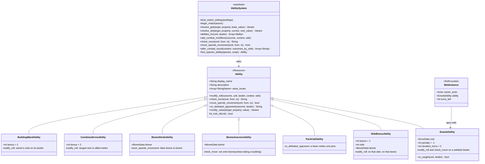

**Which abilities apply to a unit** (`AbilitySystem.abilities_for(unit, lander)`):

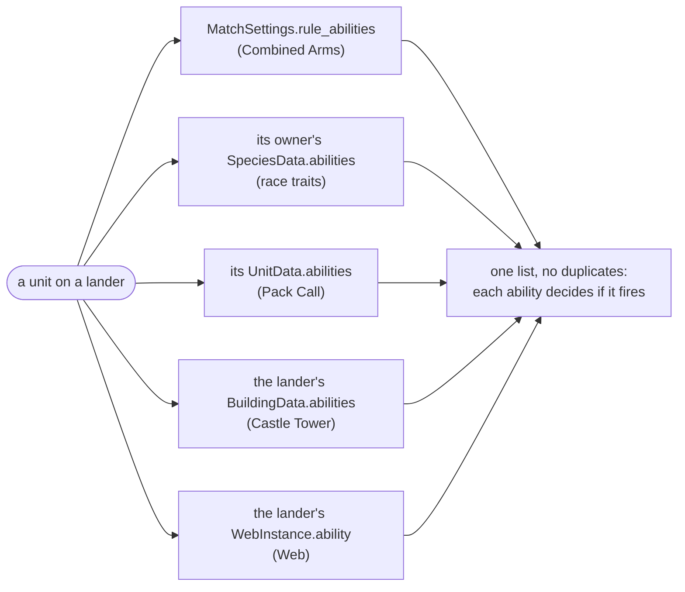

**Where the game asks them**

| Hook | Called from | Used by |
|---|---|---|
| `modify_roll` | `CombatManager._roll_side` → `AbilitySystem.add_combat_modifiers` (after the dice) | Castle Tower +2, Combined Arms +2, Lurkers +1, Web -1 |
| `check_move` | `ActionManager._validate_move_units` (and SimpleAI's planning) | Mountain Shy, Web |
| `move_spends_movement` | `ActionManager._execute(MOVE_UNITS)`, before `has_moved` is set | Forest Runners |
| `on_defeated_opponent` | `CombatManager.resolve_combat` → `AbilitySystem.after_combat_round` (after the dead are removed) | Pack Call |
| `modify_value` | `AbilitySystem.resolve_get`, only for properties listed in `value_hooks` | (none yet; the smoke test checks it works) |

| Ability | `.tres` | Attached to | Effect |
|---|---|---|---|
| Forest Runners | `forest_runners.tres` (BiomeStride) | Lycanthrope | Forest to Forest moves don't use up the unit's move |
| Mountain Shy | `mountain_shy.tres` (BiomeAversion) | Lycanthrope | Can't move onto Mountains, except to take or raze an enemy building there |
| Pack Call | `pack_call.tres` | Alpha Werewolf | Each enemy unit it kills calls a Lycanth Halfbreed to its lander, if there's room |
| Web | `web.tres` (Enweb) | Ettercap | `ENWEB` (1 gold, 2 mineral) on a lander next to yours: non-Ettercaps on it get -1 and can't move off; one spends its move on `RAZE_WEB`, or it wears off after 2 of the owner's turns |
| Lurkers | `lurkers.tres` (SideBonus) | Ettercap | +1 when defending a Mountain |
| Castle Tower | `castle_tower_ward.tres` (BuildingWard) | Castle Tower | The owner's units fighting on its lander get +2 |
| Combined Arms | `combined_arms.tres` | Match rule | Ranged units get +2 when allied melee units fight alongside them |

---

## 3. Runtime model

These objects exist while a match is running. `Action`, `Contest`, `CombatOutcome`, `UnitInstance`,
`BuildingInstance` and `WebInstance` are `RefCounted`: they free themselves when nothing references them.

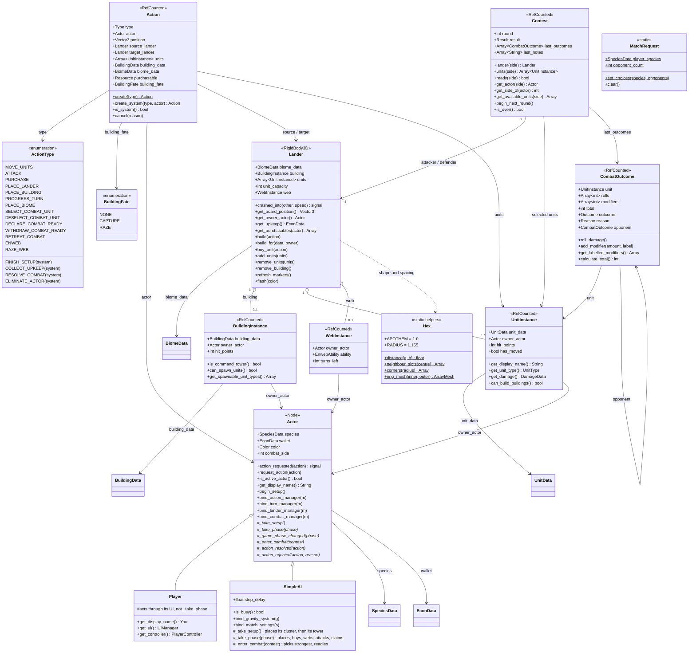

Notes:

* `PLACE_BUILDING` is only the free command tower at the end of setup. Everything else is bought
  with `PURCHASE`, on `target_lander`.
* *System* actions are made with `Action.create_system()` and can't be requested by an actor.
* A lander has **no owner field**. `get_owner_actor()` works it out: the building's owner, otherwise the
  first unit's owner, otherwise `null` (neutral).
* **Hex landers.** Every lander is the same hexagon, pointy along +Z, and never rotates.
  `Hex.distance` is the face-to-face measure: two landers face to face are exactly 2.0 apart, they
  overlap below that, and they're *connected* up to 2.5.
* **One move per turn.** `UnitInstance.has_moved` is set by `MOVE_UNITS` (unless an ability makes the
  move free) and cleared at the owner's `COLLECT_UPKEEP`. Fighting doesn't count as a move.
* `CombatOutcome` keeps a label for each modifier (e.g. `[2, "Castle Tower"]`) so the battle dialog can
  say where it came from, and `opponent` (the outcome it was paired against) so kill reactions know
  who died. The enums are `Outcome {DEAD, ALIVE}` and
  `Reason {COMBAT_LOST, COMBAT_WON, ABILITY_SAVED, ABILITY_LOST, ABILITY_WON, NO_COMBAT}`.
* `MatchRequest` carries the menu choices (section 5). It's static, so it survives the scene change
  and "Play again".

---

## 4. Managers and actors

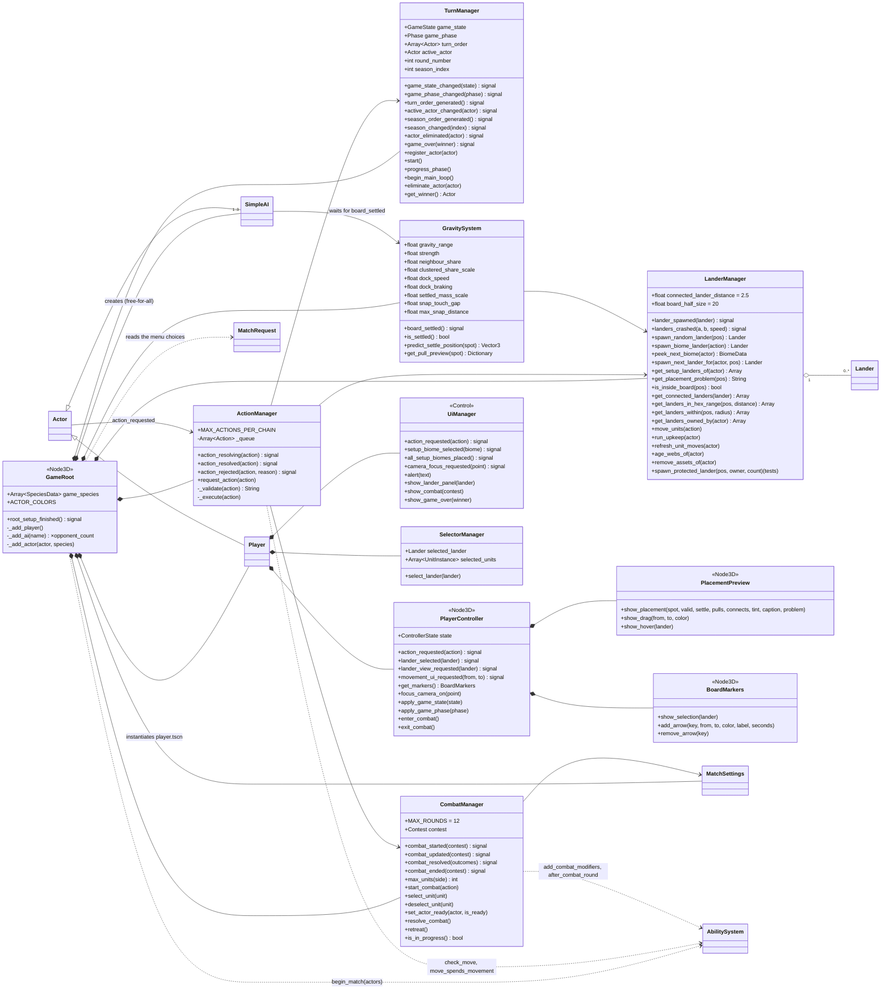

The managers only *execute*. All rule checks live in `ActionManager._validate()` (plus the abilities'
`check_move`), and the managers' methods are called from `ActionManager._execute()`. `EconManager` is an
empty placeholder and isn't shown. `Draw3D` is a debug drawing helper that `GameRoot` hands to the
`Player`.

**GravitySystem in short:** a new lander pulls (and is pulled by) landers within `gravity_range` for
`pull_duration`. Its speed is capped by its gap to the nearest lander (docking), its pull ends when it
touches another, settled landers are heavier, and landers already in a cluster barely feel the pull.
When everything stops, each lander that moved and touches another slides into the nearest free
face-to-face slot (snapping), then `board_settled` fires. Four invisible walls stand at
`board_half_size`.

---

## 5. Screens, scene tree and signal wiring

**Screens.** The project starts on the start screen (`run/main_scene`). The tests load `main.tscn`
directly, so `MatchRequest` is empty and the defaults apply (a random race, `opponent_count` AIs).

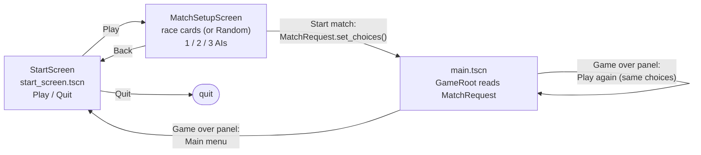

**Signal wiring in the game scene.** Solid arrows are signal connections, labelled with the signal
name. Dotted arrows are direct calls. `GameRoot._add_actor()` wires every actor the same way, and each
actor connects its own manager signals in its `bind_*()` methods.

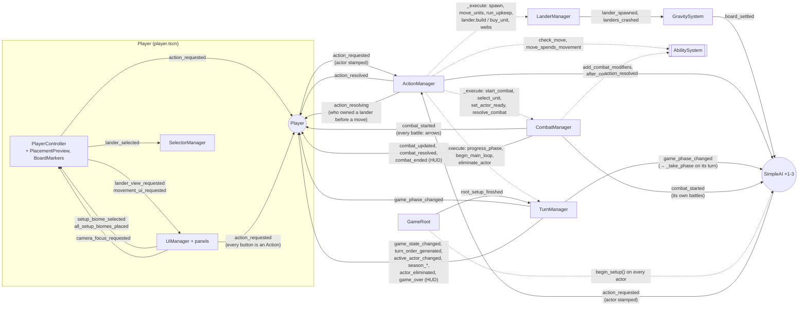

Every actor listens to the same signals; the Player adds HUD-only ones, and listens to *every*
battle (not just its own) so the board can show who is attacking whom.

---

## 6. HUD and board markers

`UiManager` builds the HUD in code (`view/hud/`, styled by `HudTheme`). Every panel's
`action_requested` is connected up to `UiManager.action_requested`, so every button press leaves
the HUD as an `Action` (the Player stamps itself on it). The root ignores the mouse, so clicks on
empty screen reach the board.

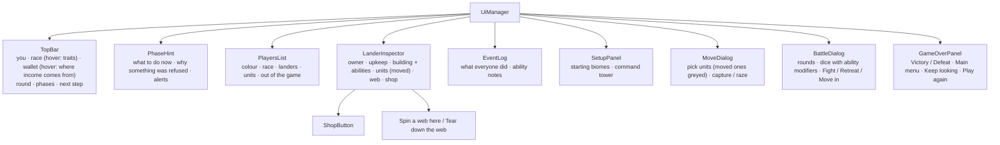

| Panel | Sends |
|---|---|
| `TopBar` next-step button | `PROGRESS_TURN` (End buying / End turn) |
| `SetupPanel` biome button | `setup_biome_selected` → the controller places on click (`PLACE_BIOME`) |
| `ShopButton` in the inspector | `PURCHASE` on that lander |
| Inspector web buttons | `ENWEB` (Spin a web here), `RAZE_WEB` (Tear down the web) |
| `MoveDialog` | `MOVE_UNITS` (with `building_fate` CAPTURE / RAZE for undefended enemy buildings) |
| `BattleDialog` | `SELECT` / `DESELECT_COMBAT_UNIT`, `DECLARE` / `WITHDRAW_COMBAT_READY`, `RETREAT_COMBAT` |

**On the board** (owned by the `PlayerController`):

| Node | Shows |
|---|---|
| `PlacementPreview` | The hex ghost tinted and labelled with the next lander's biome, where gravity will pull and snap it, the landers pulling on it and the ones it will connect to (the hex connection range); a drag ribbon while moving or attacking; a hover ring |
| `BoardMarkers` | A pulsing white ring on the lander in the side panel; an arrow from attacker to defender for every battle until it ends ("UNDER ATTACK!" when it's yours); short arrows for other players' moves ("Captured!" / "Razed!") |
| `Lander` itself | Its owner ring and label (unit count, owner, web turns left), and a web drawn over it while webbed |

---

## 7. The Action pipeline

Every change to the game state takes this route, whether a player, the AI or the game itself asked
for it.

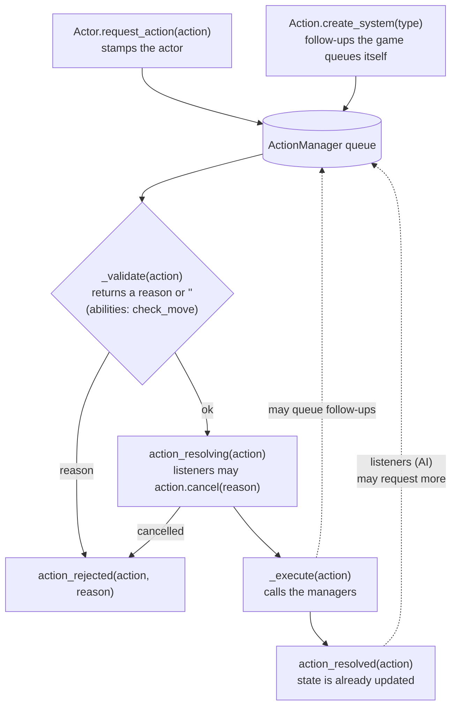

**What `_validate` checks**

| Action | Allowed when |
|---|---|
| `PLACE_BIOME` | Setup; the actor has placed fewer than `starting_biome_count`; the spot is inside the walls and clear |
| `PLACE_BUILDING` | Setup; it's the actor's command tower; the lander is one the actor placed in setup and has no building; the actor has no tower yet |
| `FINISH_SETUP` | System only; setup; every actor has a command tower |
| `PLACE_LANDER` | Main loop; actor's turn; `DUSTCLOUD_COLLAPSE`; the spot is inside the walls and clear |
| `PURCHASE` | Actor's turn; `BUYING`; actor owns the lander; the lander offers it (its building trains that unit type, or one of the actor's `can_build` units there can build it); affordable; room for a unit / no building yet; a unique building only once |
| `ENWEB` | Actor's turn; `BUYING`; the actor's race has `EnwebAbility`; the target isn't theirs, has no web, and is connected to a lander they own; affordable |
| `MOVE_UNITS` | Actor's turn; `COMBAT`; no combat running; landers connected; the actor's own units, on the source, none moved yet this turn; every ability's `check_move` agrees (Mountain Shy, webs); no enemy units on the target; room; an undefended enemy building needs `building_fate` CAPTURE or RAZE (a command tower can only be razed) |
| `RAZE_WEB` | Actor's turn; `COMBAT`; no combat running; the target has someone else's web; one of the actor's units on it that hasn't moved this turn (it spends its move) |
| `ATTACK` | Actor's turn; `COMBAT`; no combat running; landers connected; both have units (no defenders: move in instead); attacker owns its side, enemy on the other |
| `PROGRESS_TURN` | Main loop; actor's turn; not an admin phase; not `DUSTCLOUD_COLLAPSE` (that ends by placing a lander); no combat running. A system `PROGRESS_TURN` skips these checks |
| `SELECT` / `DESELECT_COMBAT_UNIT` | Combat choosing units; actor takes part; its own unit on its side's lander; within the unit limit |
| `DECLARE_COMBAT_READY` | Combat choosing units; actor takes part; at least one unit selected (if it has any) |
| `WITHDRAW_COMBAT_READY` | Combat choosing units; actor takes part |
| `RETREAT_COMBAT` | Combat choosing units; the actor is the attacker |
| `COLLECT_UPKEEP`, `RESOLVE_COMBAT`, `ELIMINATE_ACTOR` | System only |

**Follow-ups the game queues itself**

| After | Queued |
|---|---|
| `PLACE_BUILDING` (the command tower), once every actor has one | `FINISH_SETUP` |
| `FINISH_SETUP` or `PROGRESS_TURN` into `UPKEEP` | `COLLECT_UPKEEP` for the active actor: their units can move again, their webs age (and wear off), they get `upkeep_gold` (3) plus each owned lander's upkeep (biome + building); then system `PROGRESS_TURN` |
| `PROGRESS_TURN` into `CLEANUP` | system `PROGRESS_TURN` |
| `PLACE_LANDER` | system `PROGRESS_TURN` (placing the lander is the whole phase) |
| `MOVE_UNITS` that razes a command tower | `ELIMINATE_ACTOR` for its owner: their units, buildings and webs are removed and they leave the turn order. When one actor is left the game ends (`TurnManager.game_over`); with more left, play goes on |
| `DECLARE_COMBAT_READY` when both sides are ready | `RESOLVE_COMBAT`. If both sides still have units afterwards, the next round starts (survivors stay selected); otherwise the battle ends (`combat_ended`) |

---

## 8. Playthrough: menus, setup and two rounds

This traces a short game through the real code paths: the human `Player` and the default two
`SimpleAI`s (free-for-all). The turn order is shuffled at start; here the Player is assumed to go
first, and each AI plays its turn by itself when its turn comes. The diagrams show "SimpleAI" once;
every AI does the same.

**Phases each turn:** `UPKEEP → DUSTCLOUD_COLLAPSE → BUYING → COMBAT → CLEANUP`.
`UPKEEP` and `CLEANUP` are *admin phases*: the game passes through them with system actions.
After `CLEANUP` the next actor's `UPKEEP` starts. When play wraps back to the first actor, the round
number goes up and the season advances.

**Reading these diagrams:** every arrow into `ActionManager` is queued. "resolve" marks the moment the
queue gets to that action. Anything requested while an action is resolving waits its turn, so a long
chain runs one action at a time, in order. The AI paces itself: before each step it waits
`step_delay` and for `board_settled`.

### 8a. Menus, boot and setup

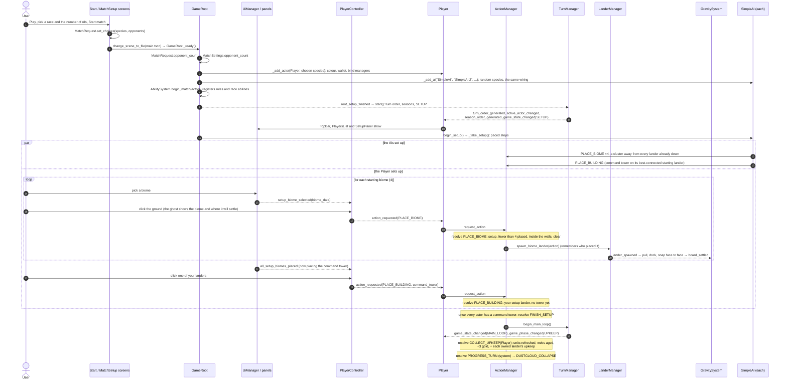

### 8b. Round 1 (season 1)

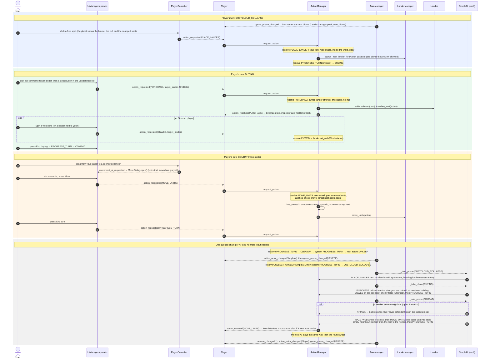

### 8c. Round 2 (season 2)

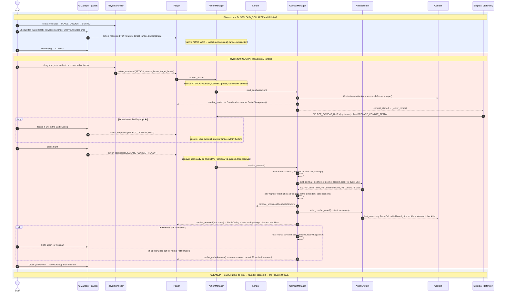

### What changed in the game state

| Moment | State changes (all through hooked setters) |
|---|---|
| Menus | `MatchRequest.player_species`, `MatchRequest.opponent_count` |
| Boot | Each actor: `species`, `color`, `wallet` (10 of each resource); `AbilitySystem` registers what's in play |
| Setup | Each actor: 4 biome landers (pulled and snapped together); a command tower `BuildingInstance` on one (now owned). No starting units. `game_state`: SETUP → MAIN_LOOP; first upkeep paid |
| R1 Dustcloud | +1 neutral lander of the previewed biome; the next one is rolled |
| R1 Buying | `wallet` −unit cost; `Lander.units` +1 `UnitInstance`; (Ettercap) `Lander.web` set |
| R1 Combat | `Lander.units` moved to the neighbour, which becomes Player-owned; the moved units' `has_moved` = true |
| R1 → R2 | `active_actor` Player → each AI → Player; each AI's upkeep, purchases and moves; `round_number` 2; `season_index` 1; the Player's upkeep clears `has_moved` and ages webs |
| R2 Buying | `wallet` −building cost; `Lander.building` = new `BuildingInstance` |
| R2 Combat | `CombatManager.contest` created; `Contest.units` / `ready` per side filled; each `CombatOutcome`'s rolls, labelled modifiers, opponent, total and reason set; dead units removed; Pack Call may add a unit; `Contest.last_notes` filled |

---

## 9. Who built what

The project has two authors: **you** (391 commits, March 2025 to April 2026) and **Claude** (49
commits, 8 to 9 November 2026, every one asked for by you; commits with a `Co-Authored-By: Claude`
line). You made the game and its first working version; Claude restructured it and built the later
features you asked for on top.

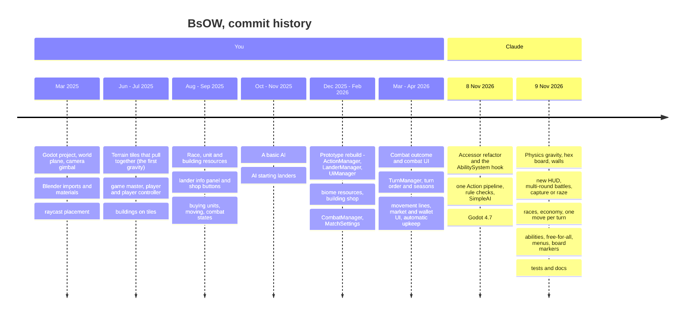

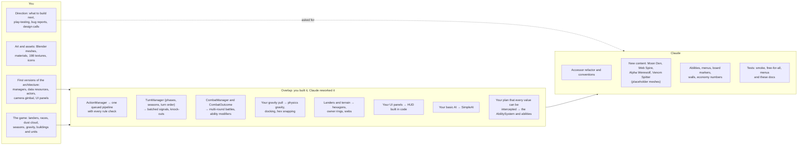

**The numbers**

| | You | Claude |
|---|---|---|
| Commits | 391 | 49 (4 of them merges into `prototype`) |
| When | Mar 2025 – Apr 2026 (14 months) | 8 – 9 Nov 2026 (2 days) |
| Non-script files added (scenes, resources, art) | 239, including 198 textures | 20: ability `.tres` files, the new race content, menu and test scenes |
| Script lines, by last edit (`git blame`) | 719 of 9,673 | 8,954 of 9,673 |
| Scripts with lines from both of us | 28 of 60 | 28 of 60 |

The `git blame` line counts understate your part. Claude's first refactor renamed, moved and
re-typed almost every script, so a line you wrote and Claude re-indented now counts as Claude's.
The structure underneath (the managers, the data resources, Actor and Player, the turn and combat
flow) is yours: the refactor kept it and changed how values are read and written.

**How the work differs**

| | You | Claude |
|---|---|---|
| Starting point | An empty Godot project | A working prototype (yours) |
| Decided | What the game is, its rules and races, what to build next, how it should feel | How to build each request, the numbers (costs, gravity tuning), small rule fixes it flagged to you (e.g. the Mountain Shy exception) |
| Made | Art, assets, scenes, the first version of every core system | Restructuring, the rules engine, AI behaviour, new systems on request, tests, docs |
| Checked by | Playing it | The headless tests and screenshots, then your play-testing |

