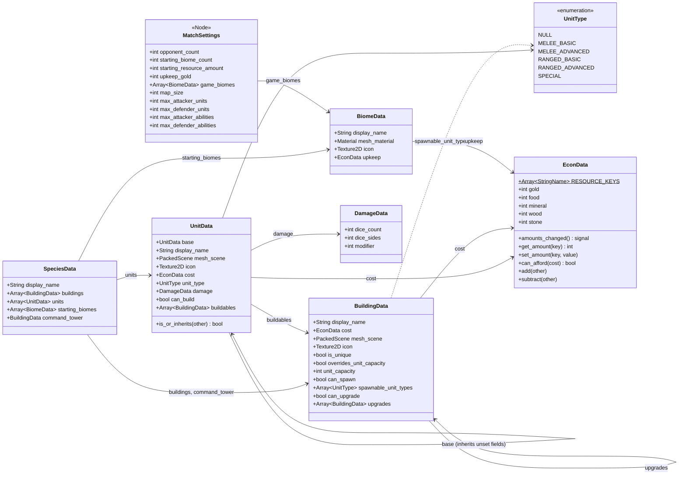
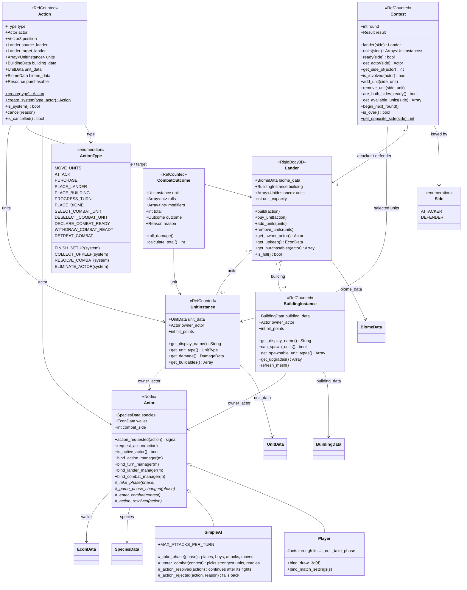
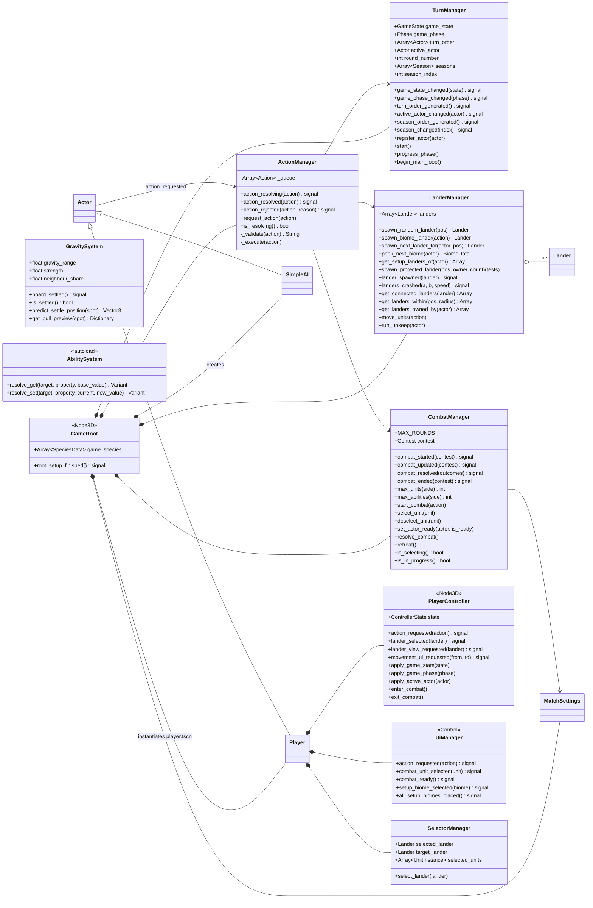
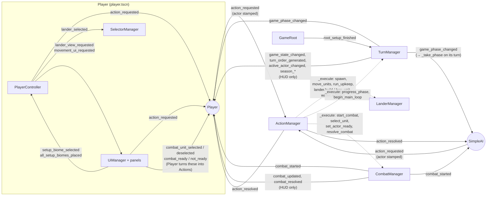
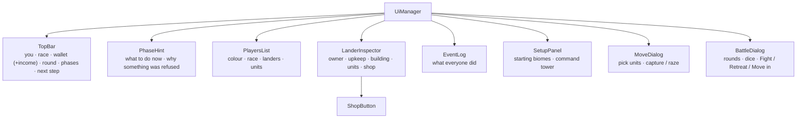
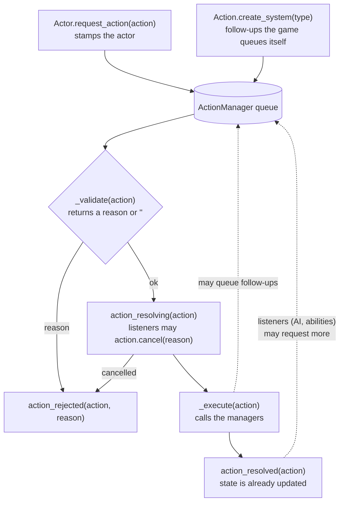
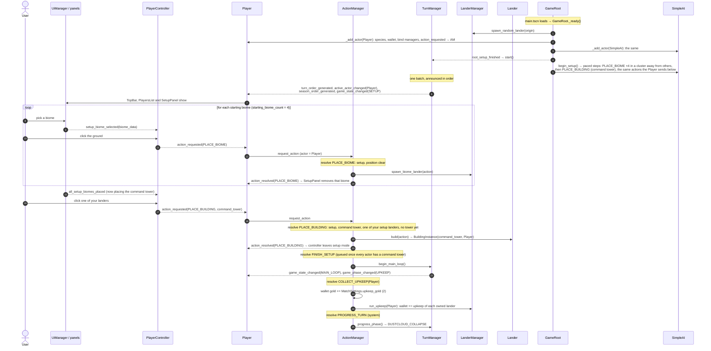
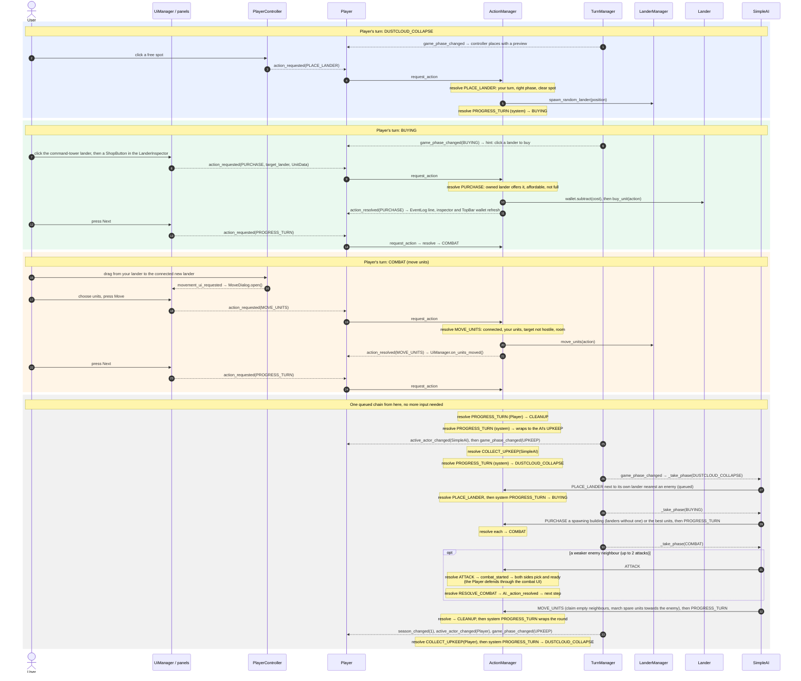
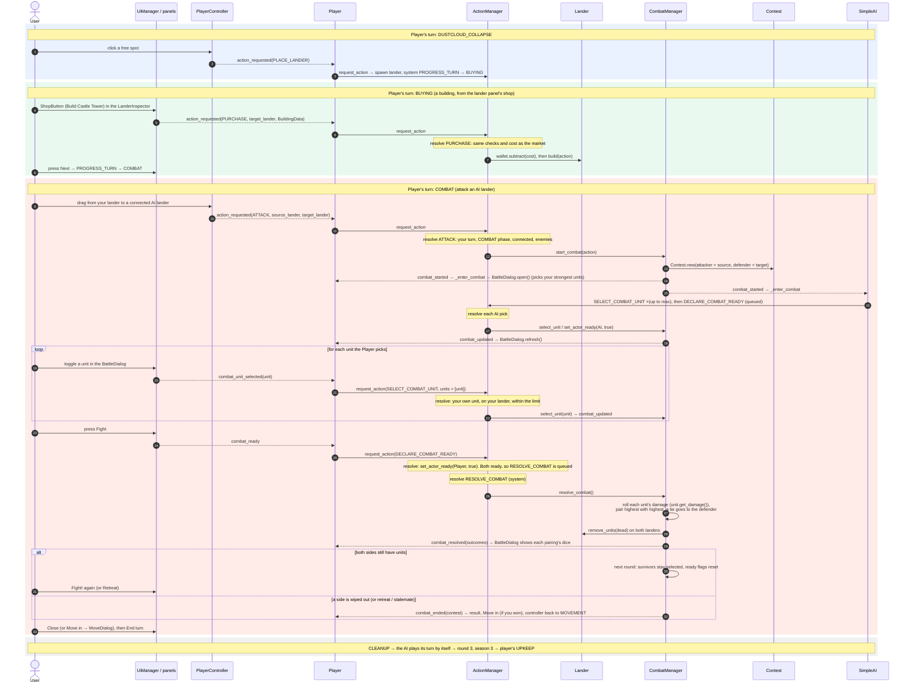

# BsOW diagrams

Mermaid diagrams of the code on `CluadeRefactor`. GitHub renders them directly; in VS Code, install
the *Markdown Preview Mermaid Support* extension and open the Markdown preview.

**Reading the class diagrams:** every field listed on a `data/` or `logic/` class is read and written
through `get_x()` / `set_x()` (or `is_x()` / `has_x()` / `can_x()`), and those accessors go through
`AbilitySystem.resolve_get()` / `resolve_set()`. The accessors themselves are left out to keep the
diagrams small.

1. [Data resources](#1-data-resources-authored-templates)
2. [Runtime model](#2-runtime-model)
3. [Managers and actors](#3-managers-and-actors)
4. [Scene tree and signal wiring](#4-scene-tree-and-signal-wiring)
5. [UI panels](#5-ui-panels)
6. [The Action pipeline](#6-the-action-pipeline)
7. [Playthrough: setup and two rounds](#7-playthrough-setup-and-two-rounds)

---

## 1. Data resources (authored templates)

`*Data` classes are `Resource`s authored in the inspector and saved as `.tres`. They are shared by every
instance made from them, so an ability that should affect *one* unit hooks `UnitInstance`, not `UnitData`.

`EconData` plays two roles: a **price or income** (`UnitData.cost`, `BiomeData.upkeep`) and an actor's
**wallet**. `UnitData.base` is an inheritance chain: a `UnitData` that leaves a field empty falls back
to its `base`.

---

## 2. Runtime model

These objects exist while a match is running. `Action`, `Contest`, `CombatOutcome`, `UnitInstance` and
`BuildingInstance` are `RefCounted`: they free themselves when nothing references them.

Notes:

* `PLACE_BUILDING` is only the free command tower at the end of setup. Everything else is bought
  with `PURCHASE`, on `target_lander`.
* *System* actions are made with `Action.create_system()` and can't be requested by an actor.
* A lander has **no owner field**. `get_owner_actor()` works it out: the building's owner, otherwise the
  first unit's owner, otherwise `null` (neutral). Abilities can still override it through the hook.
* `UnitInstance` getters such as `get_damage()` currently pass straight through to `UnitData`, but each
  one is hooked per instance. That's where buffs on a single unit go.
* The `CombatOutcome` enums are `Outcome {DEAD, ALIVE}` and
  `Reason {COMBAT_LOST, COMBAT_WON, ABILITY_SAVED, ABILITY_LOST, ABILITY_WON, NO_COMBAT}`.
  `set_reason()` also sets the matching `outcome`.

---

## 3. Managers and actors

The managers only *execute*. All rule checks live in `ActionManager._validate()`, and the managers'
methods are called from `ActionManager._execute()`. `EconManager` and `GravitySystem` exist as empty
placeholders and aren't shown. `Draw3D` is a debug
drawing helper that `GameRoot` hands to the `Player`.

---

## 4. Scene tree and signal wiring

Solid arrows are signal connections, labelled with the signal name. Dotted arrows are direct calls.
`GameRoot._add_actor()` wires every actor the same way, and each actor connects its own manager
signals in its `bind_*()` methods.

Compared to before the fixes, the wiring went from about 30 hand-made connections in `GameRoot` to one
per actor (`action_requested`). The signals each actor listens to are the same for the Player and the
AI, apart from the Player's extra HUD-only signals.

---

## 5. HUD

`UiManager` builds the HUD in code (`view/hud/`, styled by `HudTheme`). Every panel's
`action_requested` is connected up to `UiManager.action_requested`, so every button press leaves
the HUD as an `Action` (the Player stamps itself on it). The root ignores the mouse, so clicks on
empty screen reach the board.

| Panel | Sends |
|---|---|
| `TopBar` next-step button | `PROGRESS_TURN` (End buying / End turn) |
| `SetupPanel` biome button | `setup_biome_selected` → the controller places on click (`PLACE_BIOME`) |
| `ShopButton` in the inspector | `PURCHASE` on that lander |
| `MoveDialog` | `MOVE_UNITS` (with `building_fate` CAPTURE / RAZE for undefended enemy buildings) |
| `BattleDialog` | `SELECT` / `DESELECT_COMBAT_UNIT`, `DECLARE` / `WITHDRAW_COMBAT_READY`, `RETREAT_COMBAT` |

On the board, the `PlayerController` handles clicks (select a lander; drag to move or attack;
place landers) and draws the `PlacementPreview`: the ghost lander, where gravity will pull it,
the landers pulling on it and the ones it will connect to.

---

## 6. The Action pipeline

Every change to the game state takes this route, whether a player, the AI or the game itself asked
for it.

**What `_validate` checks**

| Action | Allowed when |
|---|---|
| `PLACE_BIOME` | Setup; the actor has placed fewer than `starting_biome_count`; the position is clear |
| `PLACE_BUILDING` | Setup; it's the actor's command tower; the lander is one the actor placed in setup and has no building; the actor has no tower yet |
| `PLACE_LANDER` | Main loop; actor's turn; `DUSTCLOUD_COLLAPSE`; the position is clear |
| `PURCHASE` | Actor's turn; `BUYING`; actor owns the lander; the lander offers it (its building trains that unit type, or one of the actor's `can_build` units there can build it); affordable; room for a unit / no building yet; a unique building only once |
| `MOVE_UNITS` | Actor's turn; `COMBAT`; no combat running; landers connected; actor's own units, on the source; no enemy units on the target; room; an undefended enemy building needs `building_fate` CAPTURE or RAZE (a command tower can only be razed) |
| `ATTACK` | Actor's turn; `COMBAT`; no combat running; landers connected; both have units (no defenders: move in instead); attacker owns its side, enemy on the other |
| `PROGRESS_TURN` | Main loop; actor's turn; not an admin phase; not `DUSTCLOUD_COLLAPSE` (that ends by placing a lander); no combat running. A system `PROGRESS_TURN` skips these checks |
| `SELECT` / `DESELECT_COMBAT_UNIT` | Combat choosing units; actor takes part; its own unit on its side's lander; within the unit limit |
| `DECLARE_COMBAT_READY` | Combat choosing units; actor takes part; at least one unit selected (if it has any) |
| `WITHDRAW_COMBAT_READY` | Combat choosing units; actor takes part |
| `RETREAT_COMBAT` | Combat choosing units; the actor is the attacker |
| `FINISH_SETUP`, `COLLECT_UPKEEP`, `RESOLVE_COMBAT`, `ELIMINATE_ACTOR` | System only |

**Follow-ups the game queues itself**

| After | Queued |
|---|---|
| `PLACE_BUILDING` (the command tower) | `FINISH_SETUP` |
| `FINISH_SETUP` or `PROGRESS_TURN` into `UPKEEP` | `COLLECT_UPKEEP` for the active actor (`upkeep_gold` plus each owned lander's upkeep), then system `PROGRESS_TURN` |
| `PROGRESS_TURN` into `CLEANUP` | system `PROGRESS_TURN` |
| `PLACE_LANDER` | system `PROGRESS_TURN` (placing the lander is the whole phase) |
| `MOVE_UNITS` that razes a command tower | `ELIMINATE_ACTOR` for its owner: their units and buildings are removed, they leave the turn order, and if one actor is left the game ends (`TurnManager.game_over`) |
| `DECLARE_COMBAT_READY` when both sides are ready | `RESOLVE_COMBAT`. If both sides still have units afterwards, the next round starts (survivors stay selected); otherwise the battle ends (`combat_ended`) |

---

## 7. Playthrough: setup and two rounds

This traces a short game through the real code paths: one human `Player` and one `SimpleAI`. The turn
order is shuffled at start; here the Player is assumed to go first. If the AI goes first, it plays its
turn by itself straight after setup.

**Phases each turn:** `UPKEEP → DUSTCLOUD_COLLAPSE → BUYING → COMBAT → CLEANUP`.
`UPKEEP` and `CLEANUP` are *admin phases*: the game passes through them with system actions.
After `CLEANUP` the next actor's `UPKEEP` starts. When play wraps back to the first actor, the round
number goes up and the season advances.

**Reading these diagrams:** every arrow into `ActionManager` is queued. "resolve" marks the moment the
queue gets to that action. Anything requested while an action is resolving waits its turn, so a long
chain (like the AI's whole turn) runs one action at a time, in order.

### 7a. Boot and setup

### 7b. Round 1 (season 1)

### 7c. Round 2 (season 2)

### What changed in the game state

| Moment | State changes (all through hooked setters) |
|---|---|
| Boot | `Actor.species`, `Actor.wallet` (10 of each resource) |
| Setup | Each actor: 4 biome landers; command tower `BuildingInstance` on one of them (now owned). No starting units. `game_state`: SETUP → MAIN_LOOP; first upkeep paid |
| R1 Dustcloud | +1 neutral lander |
| R1 Buying | `wallet` −unit cost; `Lander.units` +1 `UnitInstance` |
| R1 Combat | `Lander.units` moved to the neighbour, which becomes Player-owned |
| R1 → R2 | `active_actor` Player → AI → Player; AI upkeep, AI purchases (if any); `round_number` 2; `season_index` 1; Player upkeep |
| R2 Buying | `wallet` −building cost; `Lander.building` = new `BuildingInstance` |
| R2 Combat | `CombatManager.contest` created; `Contest.units` / `ready` per side filled; `CombatOutcome` totals and reasons set; dead units removed from both landers |
