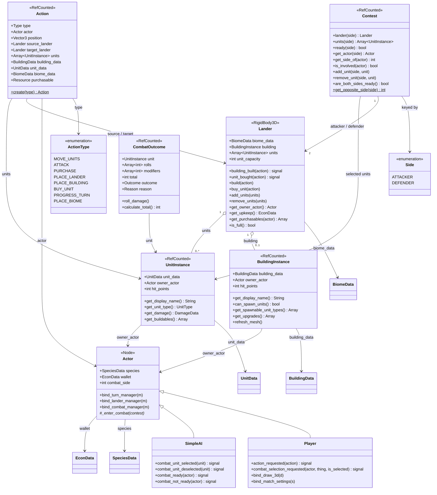
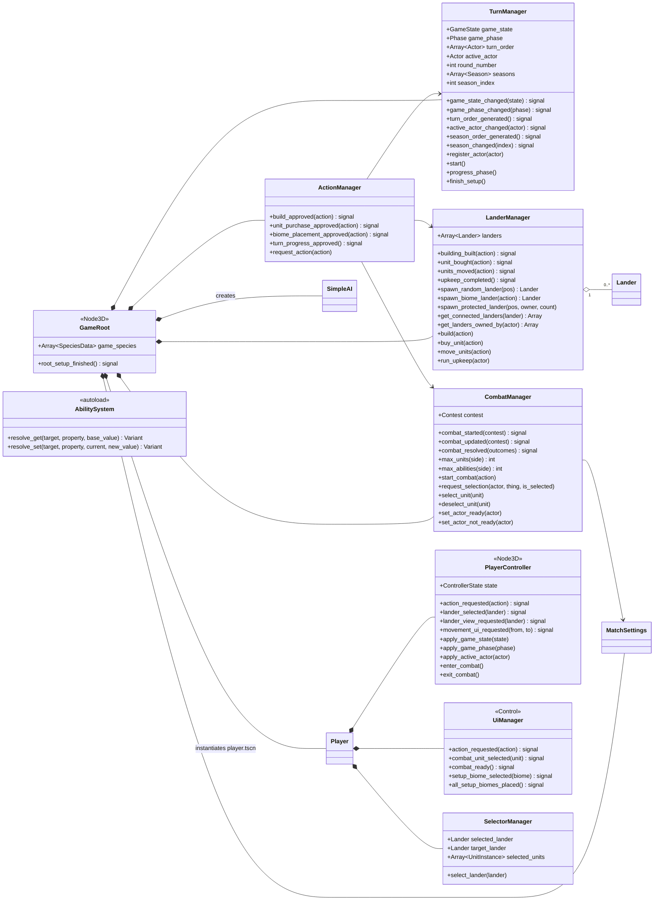
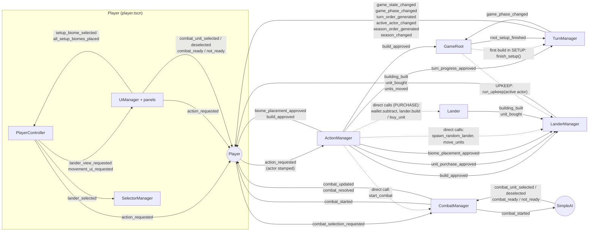
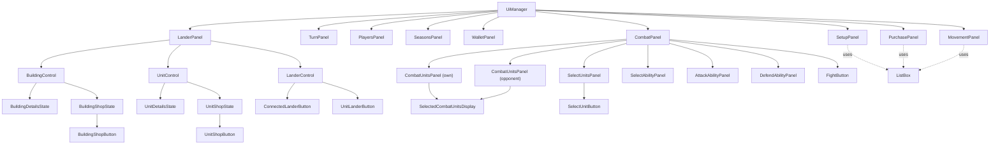
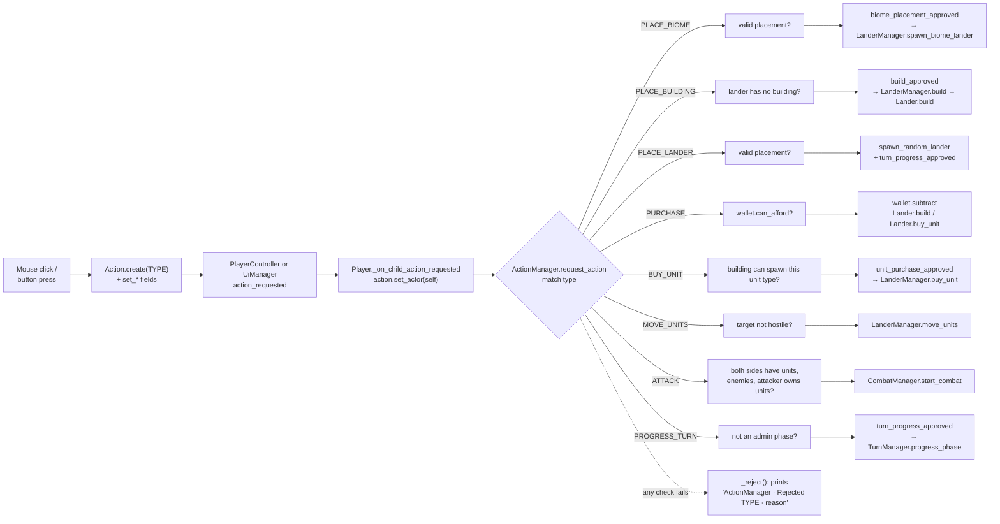
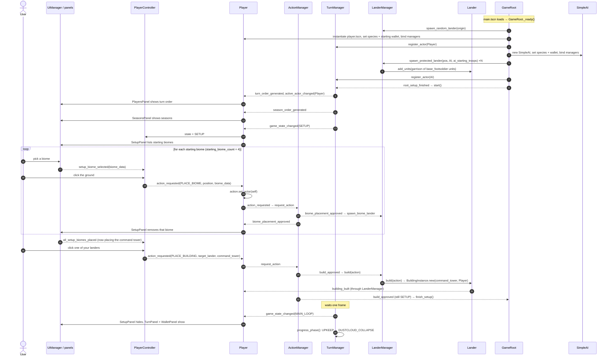
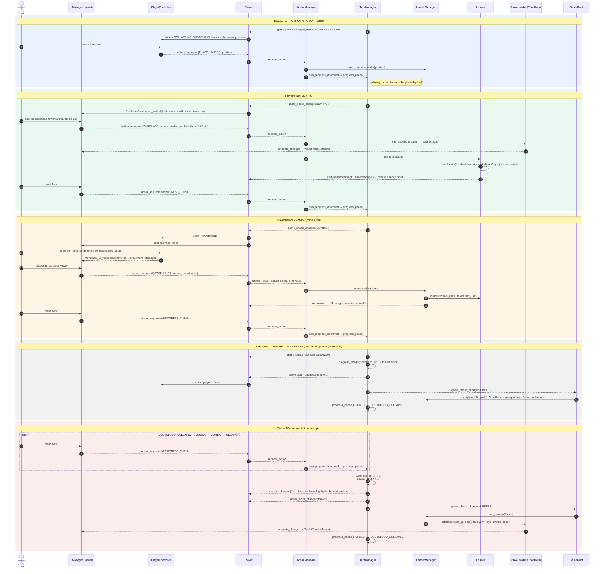
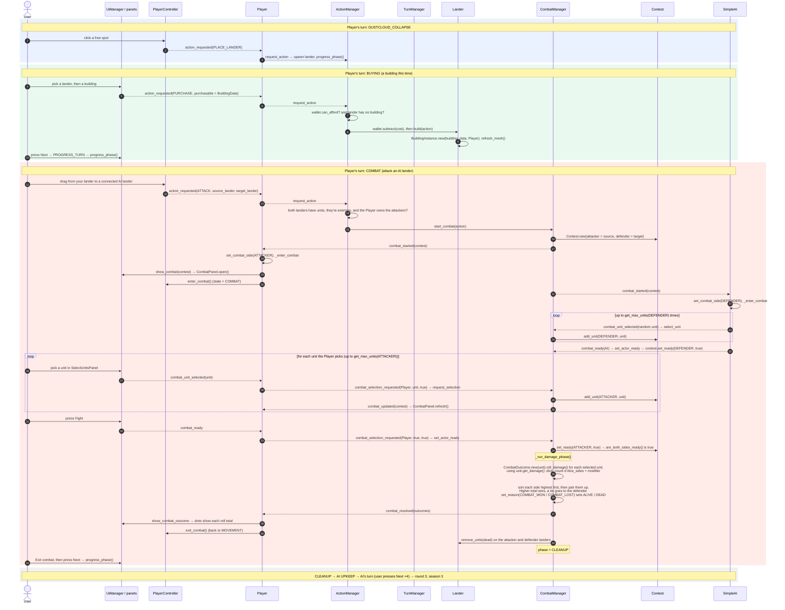

# BsOW diagrams

Mermaid diagrams of the code on `CluadeRefactor`. GitHub renders them directly; in VS Code, install
the *Markdown Preview Mermaid Support* extension and open the Markdown preview.

**Reading the class diagrams:** every field listed on a `data/` or `logic/` class is read and written
through `get_x()` / `set_x()` (or `is_x()` / `has_x()` / `can_x()`), and those accessors go through
`AbilitySystem.resolve_get()` / `resolve_set()`. The accessors themselves are left out to keep the
diagrams small.

1. [Data resources](#1-data-resources-authored-templates)
2. [Runtime model](#2-runtime-model)
3. [Managers and actors](#3-managers-and-actors)
4. [Scene tree and signal wiring](#4-scene-tree-and-signal-wiring)
5. [UI panels](#5-ui-panels)
6. [The Action pipeline](#6-the-action-pipeline)
7. [Playthrough: setup and two rounds](#7-playthrough-setup-and-two-rounds)

---

## 1. Data resources (authored templates)

`*Data` classes are `Resource`s authored in the inspector and saved as `.tres`. They are shared by every
instance made from them, so an ability that should affect *one* unit hooks `UnitInstance`, not `UnitData`.

`EconData` plays two roles: a **price or income** (`UnitData.cost`, `BiomeData.upkeep`) and an actor's
**wallet**. `UnitData.base` is an inheritance chain: a `UnitData` that leaves a field empty falls back
to its `base`.

---

## 2. Runtime model

These objects exist while a match is running. `Action`, `Contest`, `CombatOutcome`, `UnitInstance` and
`BuildingInstance` are `RefCounted`: they free themselves when nothing references them.

Notes:

* A lander has **no owner field**. `get_owner_actor()` works it out: the building's owner, otherwise the
  first unit's owner, otherwise `null` (neutral). Abilities can still override it through the hook.
* `UnitInstance` getters such as `get_damage()` currently pass straight through to `UnitData`, but each
  one is hooked per instance. That's where buffs on a single unit go.
* The `CombatOutcome` enums are `Outcome {DEAD, ALIVE}` and
  `Reason {COMBAT_LOST, COMBAT_WON, ABILITY_SAVED, ABILITY_LOST, ABILITY_WON, NO_COMBAT}`.
  `set_reason()` also sets the matching `outcome`.

---

## 3. Managers and actors

`EconManager` and `GravitySystem` exist as empty placeholders and aren't shown. `Draw3D` is a debug
drawing helper that `GameRoot` hands to the `Player`.

---

## 4. Scene tree and signal wiring

Solid arrows are signal connections, labelled with the signal name. `GameRoot._ready()` makes every
cross-object connection; `Player` connects its own children.

---

## 5. UI panels

`UiManager` owns the HUD. Each panel's `action_requested` is connected signal-to-signal up to
`UiManager.action_requested`, so every button press leaves the UI as an `Action`.

| Panel | Emits | Action / signal |
|---|---|---|
| `SetupPanel` | biome picked from the list | `setup_biome_selected` → controller waits for a click on the ground |
| `TurnPanel` | *Next* pressed | `PROGRESS_TURN` |
| `PurchasePanel` | market item pressed | `PURCHASE` (purchasable = `UnitData` or `BuildingData`) |
| `MovementPanel` | *Move* pressed | `MOVE_UNITS` |
| `BuildingShopButton` / `UnitShopButton` | shop item pressed | `PLACE_BUILDING` / `BUY_UNIT` |
| `CombatPanel` | unit chosen, *Fight* pressed | `combat_unit_selected`, `combat_ready` |

---

## 6. The Action pipeline

Every player request takes the same route. The controller and UI never set the actor; `Player` stamps
it, so the `ActionManager` always knows who asked.

---

## 7. Playthrough: setup and two rounds

This traces a short game through the real code paths: one human `Player` and one `SimpleAI`. The turn
order is shuffled at start; here the Player is assumed to go first.

**Phases each turn:** `UPKEEP → DUSTCLOUD_COLLAPSE → BUYING → COMBAT → CLEANUP`.
`UPKEEP` and `CLEANUP` are *admin phases*: `TurnManager` announces them and moves on by itself.
After `CLEANUP` the next actor's `UPKEEP` starts. When play wraps back to the first actor, the round
number goes up and the season advances.

> **Current behaviour worth knowing:** `SimpleAI` only reacts to combat. It has no turn logic, so on
> its turn the human presses *Next* until play returns to them. Also, the very first main-loop turn
> starts at `DUSTCLOUD_COLLAPSE`: `finish_setup()` progresses out of the initial `UPKEEP` without
> announcing it, so no upkeep is paid on turn 1.

### 7a. Boot and setup

### 7b. Round 1 (season 1)

### 7c. Round 2 (season 2)

### What changed in the game state

| Moment | State changes (all through hooked setters) |
|---|---|
| Boot | `Actor.species`, `Actor.wallet` (10 of each resource), AI garrison units on its landers |
| Setup | 4 biome landers placed; command tower `BuildingInstance` on one of them, so the Player owns it. `game_state`: SETUP → MAIN_LOOP |
| R1 Dustcloud | +1 neutral lander |
| R1 Buying | `wallet` −unit cost; `Lander.units` +1 `UnitInstance` |
| R1 Combat | `Lander.units` moved from the source lander to the target. The target becomes Player-owned because its units belong to the Player |
| R1 → R2 | `active_actor` Player → AI → Player; `round_number` 2; `season_index` 1; AI then Player `wallet` += biome upkeep |
| R2 Buying | `wallet` −building cost; `Lander.building` = new `BuildingInstance` |
| R2 Combat | `CombatManager.contest` created; `Contest.units` / `ready` per side filled; `CombatOutcome` totals and reasons set; dead units removed from both landers |
